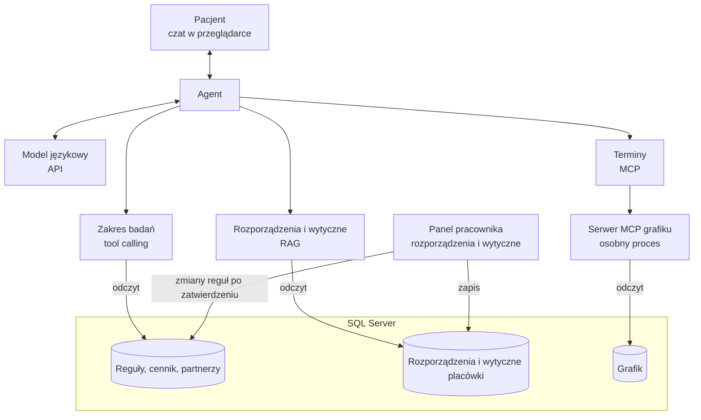

# ZbadAI – jak działa aplikacja i z czego ją budujemy

ZbadAI to aplikacja webowa z agentem AI dla jednej, konkretnej przychodni medycyny pracy. Pacjent podaje czynniki ze skierowania, a agent mówi mu, jakie badania musi wykonać, które z nich zrobi w placówce, a które we własnym zakresie, ile to potrwa i kosztuje oraz kiedy może przyjść.

Kluczem aplikacji jest źródło wiedzy: agent opiera się na rozporządzeniach rządowych, które określają, jakie badania wykonać przy jakich czynnikach. Gdy przepisy się zmienią, pracownik wgrywa nowe rozporządzenie i poleca agentowi zaktualizować bazę. Placówka może do tego dodać własne wytyczne uzupełniające, np. jak przygotować się do badań.

Aplikacja działa po polsku i nie rezerwuje wizyt.

## Część 1. Jak działa aplikacja

### Kto z niej korzysta

| Kto | Co robi |
| --- | --- |
| Pacjent | Rozmawia z agentem na stronie: podaje czynniki ze skierowania tekstem albo zdjęciem |
| Pracownik placówki | Wgrywa rozporządzenia i poleca agentowi aktualizację bazy, wpisuje dodatkowe wytyczne placówki, prowadzi cennik, grafik i listę placówek partnerskich, umawia wizyty przez telefon |

Lekarze nie korzystają z aplikacji. Zależą od nich tylko terminy.

### Co pacjent dostaje

1. **Zakres badań:** lista badań i specjalistów wynikająca z czynników na skierowaniu, z podaniem przepisu, z którego wynika.
2. **Gdzie wykonać:** które badania są w placówce (krew, okulista), a które pacjent robi we własnym zakresie; jeśli placówka ma umowę z konkretnym miejscem, agent je poleca.
3. **Przygotowanie:** np. czy przyjść na czczo, co zabrać; z wytycznych placówki.
4. **Czas i koszt:** orientacyjny czas wizyty i suma cen badań wykonywanych w placówce.
5. **Termin:** najbliższe możliwe terminy, w wariantach opisanych niżej.
6. **Jak zarezerwować:** telefon do placówki; pacjent dzwoni z wybranym terminem, a wizytę wpisuje pracownik.

### Jak pracuje placówka

| Co | Kiedy |
| --- | --- |
| Lekarz medycyny pracy nr 1 | wtorek i czwartek |
| Lekarz medycyny pracy nr 2 | środa |
| Okulista na miejscu | wtorek i czwartek |
| Pobranie krwi | codziennie 8:00–9:15, niezależnie od dnia i lekarza |

Godziny przyjęć są ustalone osobno dla każdego lekarza i dnia.

Na miejscu wykonywane są tylko pobranie krwi, badanie okulistyczne i wizyta u lekarza medycyny pracy. Wszystkie pozostałe badania (np. psycholog, laryngolog, neurolog) pacjent wykonuje we własnym zakresie i przynosi wyniki na wizytę. Z niektórymi miejscami, np. z wybranymi psychologami, placówka ma umowy; agent może wtedy polecić to miejsce.

### Skąd agent bierze wiedzę

| Źródło | Co z niego pochodzi | Kto je wprowadza |
| --- | --- | --- |
| Rozporządzenia rządowe | Twarde dane: jakie badania są wymagane przy jakich czynnikach | Pracownik wgrywa plik |
| Wytyczne placówki | Informacje dodatkowe: przygotowanie do badań, co zabrać, organizacja wizyty | Pracownik wpisuje w panelu, także na polecenie lekarzy |

Wytyczne placówki uzupełniają rozporządzenia, ale nie mogą zmienić wymaganego zakresu badań.

### Zasady układania terminu

* **Lekarz medycyny pracy jest na końcu**, bo wydaje orzeczenie po pozostałych badaniach.
* **Własne wyniki:** każde badanie poza wizytą u lekarza medycyny pracy pacjent może mieć już zrobione, także krew i okulistę; nie musi go wtedy powtarzać na miejscu. Agent pyta o posiadane wyniki i pomija te badania przy szukaniu terminu i liczeniu kosztu.
* **Badania we własnym zakresie:** pacjent robi je przed wizytą u lekarza; agent przypomina, żeby przynieść wyniki.
* **Krew:** pacjent oddaje ją rano w dniu wizyty albo innego, wcześniejszego dnia (możliwe jest też przyniesienie własnych wyników).
* **Okulista:** pacjent ma trzy możliwości:
  * A: okulista i lekarz tego samego dnia (wtorek albo czwartek),
  * B: okulista jednego dnia, lekarz później innego dnia (np. wtorek i środa),
  * C: okulista we własnym zakresie poza placówką; pacjent przynosi wynik i przychodzi w dowolny dzień przyjęć.
* **Wybór lekarza:** domyślnie dowolny. Jeśli pacjent ma preferencję albo był już u jednego z lekarzy, agent szuka terminów tylko u niego.
* **Cennik** ustala placówka, jednakowo dla obu lekarzy.

### Przebieg rozmowy

1. Pacjent wpisuje czynniki albo wgrywa zdjęcie skierowania; przy zdjęciu potwierdza listę odczytanych czynników.
2. Agent ustala zakres badań na podstawie reguł z rozporządzeń i dzieli je na wykonywane w placówce i we własnym zakresie.
3. Agent wyszukuje w rozporządzeniach podstawę i szczegóły, w wytycznych placówki przygotowanie do badań, a dla badań zewnętrznych sprawdza placówki partnerskie.
4. Agent pyta o preferowanego lekarza i szuka w grafiku terminów na badania wykonywane na miejscu.
5. Agent odpowiada jedną wiadomością i odsyła do telefonu po rezerwację.

Gdy pacjent poda czynnik, którego nie ma w bazie, agent dopytuje. Gdy czegoś nie ma w rozporządzeniach ani w wytycznych placówki, mówi to wprost i podaje telefon.

### Aktualizacja wiedzy przez pracownika

1. Pracownik wgrywa w panelu nowe rozporządzenie (plik PDF albo tekst).
2. Dokument trafia do bazy wiedzy i jest od razu przeszukiwalny.
3. Pracownik poleca agentowi: „zaktualizuj bazę”. Agent porównuje dokument z obecnymi regułami i pokazuje listę zmian: nowe czynniki, dodane lub usunięte badania.
4. Pracownik zatwierdza zmiany i dopiero wtedy trafiają one do tabeli reguł.

### Czego aplikacja nie robi

* Nie rezerwuje wizyt i niczego nie zapisuje w grafiku.
* Agent pacjenta niczego nie zmienia; reguły zmienia tylko agent pracownika, po zatwierdzeniu przez pracownika.
* Nie stawia diagnoz i nie interpretuje wyników; ostateczny zakres badań ustala lekarz.
* Nie ma kont pacjentów ani płatności.

## Część 2. Bloki i narzędzia

| Blok | Co robi | Czym go robimy |
| --- | --- | --- |
| Strona czatu | Rozmowa pacjenta z agentem, wgrywanie zdjęcia skierowania | C#, .NET 10, Blazor |
| Agent | Prowadzi rozmowę, decyduje, których narzędzi użyć i w jakiej kolejności | Model GLM (wybór jeszcze do ustalenia), własny system prompt |
| Odczyt skierowania | Wyciąga czynniki ze zdjęcia | Ten sam model albo osobny model z obsługą obrazów |
| Zakres badań | Zamienia czynniki na listę badań, oznacza miejsce wykonania (placówka, we własnym zakresie, partner), sumuje czas i koszt | **Tool calling:** funkcja C# `ustal_zakres_badan` czytająca reguły z bazy |
| Terminy | Szuka wolnych terminów na badania wykonywane na miejscu, według zasad placówki | **MCP:** własny serwer grafiku, narzędzia `znajdz_wspolny_termin` i `pokaz_grafik`, dostęp do bazy tylko do odczytu |
| Baza wiedzy | Wyszukuje w rozporządzeniach, jakie badania są wymagane i na jakiej podstawie, a w wytycznych placówki przygotowanie i sprawy organizacyjne; każdy wynik ma oznaczone źródło | **RAG:** narzędzie `szukaj_w_bazie_wiedzy`, embeddingi z lokalnego modelu `bge-m3` (Ollama), wyszukiwanie po podobieństwie |
| Panel pracownika | Wgrywanie rozporządzeń i edycja wytycznych placówki, rozmowa z agentem o aktualizacji reguł, zatwierdzanie zmian | Blazor, logowanie pracownika |
| Aktualizacja reguł | Porównuje nowe rozporządzenie z regułami w bazie i przygotowuje listę zmian do zatwierdzenia | Model agenta + **tool calling:** narzędzia `zaproponuj_zmiany_regul` i `zapisz_zatwierdzone_zmiany`, dostępne tylko w panelu pracownika |
| Baza danych | Reguły czynnik - badania, miejsce wykonania badań, placówki partnerskie, cennik, grafik lekarzy i zajęte wizyty, rozporządzenia, wytyczne placówki | MS SQL Server, EF Core |
